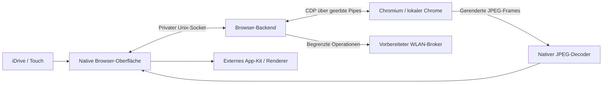

# Architektur

## Quellen

- `apps/mgu_browser/chromium_frontend.js`: Browserleiste, Tabs, Tastatur,
  Einstellungen, Bibliothek, Touch und Vollbild-Bedienung.
- `src/browser_client.js`, `src/ipc_protocol.js`: App-/Backend-Protokoll.
- `src/browser_controller.js`: gemeinsamer Decoder für Controller-Ereignisse.
- `src/browser_session.js`, `src/browser_pages.js`: Engine, CDP, Tabs,
  Eingaben, Navigation, Frame-Übertragung und Sitzungslaufzeit.
- `src/browser_media.js`, `src/browser_media_demo.js`: Medienzustand,
  Fähigkeiten, feste Videoaktionen und eigener Testclip.
- `src/browser_locale.js`, `src/browser_state.js`: Sprache, Tastaturlayouts,
  App-Einstellungen, Lesezeichen und Besuchsübersicht.
- `dev/`: privater SDK-App-Emulator und lokales Backend mit Medien.
- `backend/`: vorbereitete Headunit-Laufzeit mit deaktivierten Medien.
- `network/`: begrenzter Root-Broker, Profilverwaltung, Scan und WLAN-Helfer.
- `native/`: N-API-Helfer und Prozess-/Netzwerkprogramme als Quellcode.

Ältere HTML-Lesermodule und deren parse5-Bundle bleiben für die
Entwicklungsgeschichte vorhanden. Die aktuelle App startet `chromium_frontend`.

## Laufzeitgrenzen

Das Laptop-Backend und die Headunit-Laufzeit teilen sich Protokoll und
Browsermodule, haben aber unterschiedliche Umgebungen und Medienfreigaben.
Der Emulator ist kein vollständiges ID7-Systemabbild. Eine stabile Website
unter Desktop-Chrome beweist keine Kompatibilität mit den Systembibliotheken,
Speichergrenzen, Fahrzeugdiensten oder Audio-Schnittstellen der MGU.

Die Referenzkonfiguration trennt App, Browser und Netzwerkdienst mit eigenen
Benutzer-IDs. UID 12443 greift auf das Headunit-Backend zu; UID 3911 betreibt es
und darf den WLAN-Broker verwenden. Solche Werte sind Integrationsparameter,
keine universell garantierten BMW-Benutzerkennungen.

App-Einstellungen sind vom temporären Chromium-Profil getrennt. Cookies sind
zwischen Tabs einer Sitzung geteilt; Schließen löscht dieses Profil.
Der Heartbeat begrenzt die Lebensdauer bei verschwundener App. Der Browser
spricht keine Fahrzeugcodierung an und verändert keine Firmware.

## Noch keine Store-Veröffentlichung

Dieses Repository enthält bewusst weder `catalog.json` noch `mgu-repo.json`
und bietet keine angeblich installierbare Release-Datei an. Der Browser benötigt
zusätzlich einen qualifizierten Backend-/Engine-Installationsweg. App-ID,
HMI-Metadaten, Internetbedarf und Abhängigkeiten sollen vor einer Veröffentlichung
mit der aktuellen MGU-Store-Struktur abgeglichen werden.
