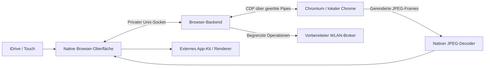

# Architektur

## Quellen

- `apps/mgu_browser/chromium_frontend.js`: Browserleiste, Tabs, Tastatur,
  Einstellungen, Bibliothek, Touch und Vollbild-Bedienung.
- `src/browser_client.js`, `src/ipc_protocol.js`: App-/Backend-Protokoll.
- `src/browser_controller.js`: gemeinsamer Decoder für Controller-Ereignisse.
- `src/browser_session.js`, `src/browser_pages.js`: Engine, CDP, Tabs,
  Eingaben, Navigation, Frame-Übertragung und Sitzungslaufzeit.
- `src/browser_media.js`, `src/browser_media_demo.js`: Medienzustand,
  Fähigkeiten, feste Videoaktionen und eigener Testclip.
- `src/browser_locale.js`, `src/browser_state.js`: Sprache, Tastaturlayouts,
  App-Einstellungen, Lesezeichen und Besuchsübersicht.
- `src/secure_browser_data.js`, `src/browser_privacy.js`: geschützte Sitzungen,
  Passworttresor und ausdrücklich ausgelöste Datenschutzaktionen.
- `dev/`: privater SDK-App-Emulator und lokales Backend mit Medien.
- `backend/`: vorbereitete Headunit-Laufzeit mit aktivierten Medien im Quellstand 0.9.0.
- `network/`: begrenzter Root-Broker, Profilverwaltung, Scan und WLAN-Helfer.
- `native/`: N-API-Helfer und Prozess-/Netzwerkprogramme als Quellcode.

Ältere HTML-Lesermodule und deren parse5-Bundle bleiben für die
Entwicklungsgeschichte vorhanden. Die aktuelle App startet `chromium_frontend`.

## Laufzeitgrenzen

Das Laptop-Backend und die Headunit-Laufzeit teilen sich Protokoll und
Browsermodule, haben aber unterschiedliche Umgebungen und Hardware-Teststände.
Der Emulator ist kein vollständiges ID7-Systemabbild. Eine stabile Website
unter Desktop-Chrome beweist keine Kompatibilität mit den Systembibliotheken,
Speichergrenzen, Fahrzeugdiensten oder Audio-Schnittstellen der MGU.

Die Referenzkonfiguration trennt App, Browser und Netzwerkdienst mit eigenen
Benutzer-IDs. UID 12443 greift auf das Headunit-Backend zu; UID 3911 betreibt es
und darf den WLAN-Broker verwenden. Solche Werte sind Integrationsparameter,
keine universell garantierten BMW-Benutzerkennungen.

App-Einstellungen sind vom aktiven Chromium-Profil getrennt. Cookies sind
zwischen Tabs einer Sitzung geteilt. Nach sauberem Beenden wird das ausgewählte
Profilmaterial verschlüsselt archiviert und der aktive Arbeitsordner gelöscht.
Ohne aktivierte Persistenz bleibt die Sitzung vollständig temporär.
Der Heartbeat begrenzt die Lebensdauer bei verschwundener App. Der Browser
spricht keine Fahrzeugcodierung an und verändert keine Firmware.

Der Speicher verwendet AES-256-GCM und einen zufälligen 256-Bit-Schlüssel.
Windows DPAPI schützt diesen Schlüssel im Laptop-Modus über den aktuellen
Windows-Benutzer. Die MGU-Variante schützt ihn über einen mit PBKDF2-SHA256,
600.000 Iterationen und zufälligem Salt aus dem Masterpasswort abgeleiteten
Schlüssel. Die Masterpasswort-Einrichtung wird bestätigt; ein Backend-Neustart
erfordert erneutes Entsperren. Dateien liegen im vorgesehenen Benutzerkonto
unter einem Verzeichnis mit Modus 0700, einzelne Speicherdateien mit 0600.
Während des Betriebs benötigt Chromium entschlüsselte Arbeitsdaten und der
Backendprozess den Schlüssel im Speicher. Dies schützt nicht gegen einen
bereits kontrollierten laufenden Prozess oder Root-Zugriff.

Profildaten werden nur nach dem Beenden von Chromium gelesen. Pfade und
Dateigrößen sind begrenzt; Symlinks, fremde Dateitypen, Chromium-Verlauf und
dessen eigene Passwortdatenbanken werden nicht übernommen. Der eigene
Passworttresor ist getrennt vom Sitzungsarchiv. Ein Stromausfall seit dem letzten
sauberen Beenden bleibt ein offener Fall für periodische konsistente Sicherung.

## Noch keine Store-Veröffentlichung

Dieses Repository enthält bewusst weder `catalog.json` noch `mgu-repo.json`
und bietet keine angeblich installierbare Release-Datei an. Der Browser benötigt
zusätzlich einen qualifizierten Backend-/Engine-Installationsweg. App-ID,
HMI-Metadaten, Internetbedarf und Abhängigkeiten sollen vor einer Veröffentlichung
mit der aktuellen MGU-Store-Struktur abgeglichen werden.
